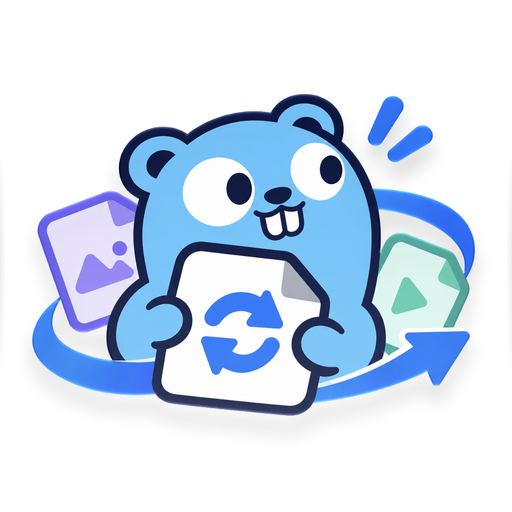
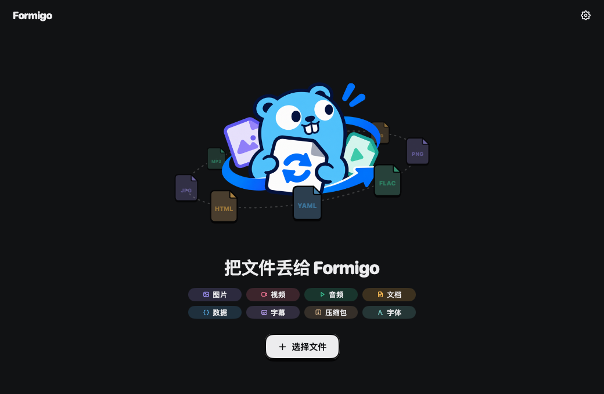
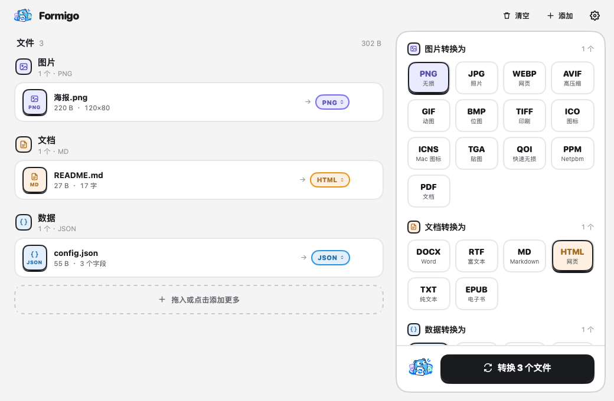
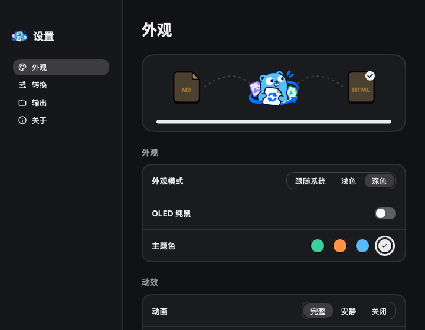
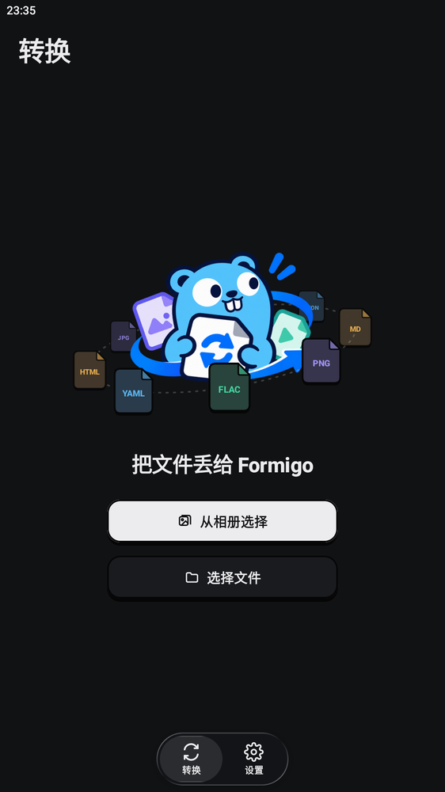
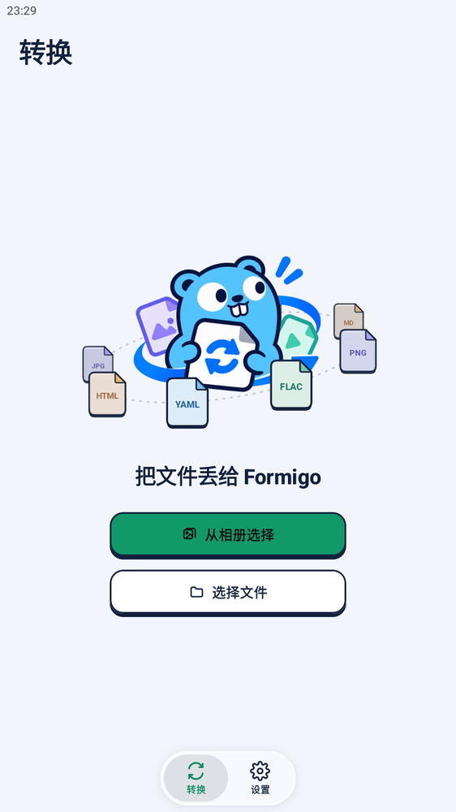
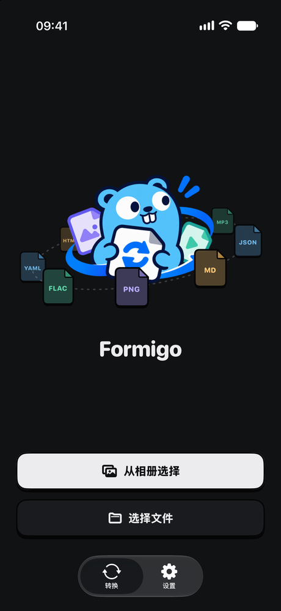
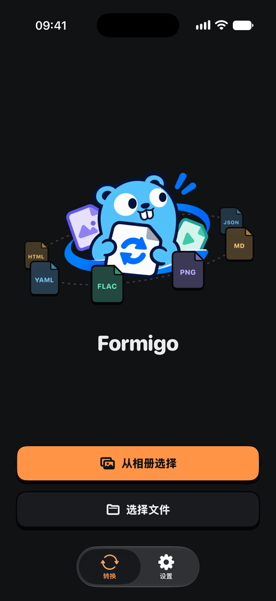
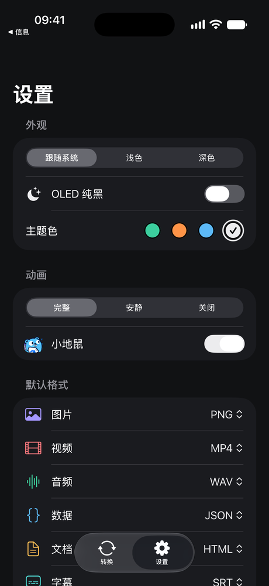

<p align="center">
  
</p>

<h1 align="center">Formigo</h1>

<p align="center">
  把文件丢给小地鼠：在本机完成图片、视频、音频、文档、数据等格式互转<br>
  <i>文件不上传，转换都在你的设备上完成。</i>
</p>

<p align="center">
  
  
  
  
</p>

<p align="center">
  
</p>

## 下载

到 [Releases](https://github.com/Souitou-iop/Formigo/releases/latest) 下载对应设备的安装包：

| 平台 | 安装包 |
| --- | --- |
| macOS（Apple 芯片与 Intel 通用） | DMG |
| Windows x64 | 安装版 EXE / 免安装 ZIP |
| Linux x64 | DEB / RPM / tar.gz |
| Android 9 及以上 | APK |
| iOS 17 及以上 | 未签名 IPA（需自行签名） |

## 功能

### 格式

| 类型 | 格式 |
| --- | --- |
| 图片 | PNG、JPG、WebP、AVIF、HEIC、GIF、BMP、TIFF、ICO、ICNS、TGA、QOI、PPM、SVG（读取）、JPEG XL |
| 视频 | MP4、MOV、MKV、WebM、AVI、WMV、FLV、M4V、TS、3GP、MPG、OGV，也能导出 GIF、截图或提取音轨 |
| 音频 | MP3、M4A、AAC、WAV、FLAC、OGG、Opus、AIFF、WMA、AMR、APE、WavPack、CAF、AC3、MKA |
| 文档 | PDF（转图片、提取文字）、DOCX、Markdown、HTML、TXT、EPUB、RTF；装有 LibreOffice 时另支持 DOC、ODT、PPT、PPTX、ODP、XLS、ODS |
| 数据 | JSON、JSON Lines、YAML、TOML、XML、CSV、TSV、XLSX、Plist |
| 字幕 | SRT、VTT、ASS、LRC |
| 压缩包 | ZIP、7Z、RAR、TAR、TAR.GZ、TAR.BZ2、TAR.XZ、GZ 解压，文件夹打包为 ZIP、TAR、TAR.GZ |
| 字体 | TTF、OTF、WOFF、WOFF2 |

上表是桌面端的格式；Android 与 iOS 由各自的原生引擎转换，支持的格式以应用内显示为准。

### 桌面端

- 拖进窗口或点「选择文件」，自动识别类型并分组；每组选目标格式，或用「全部转为」一次设好整批
- 一步转不了时自动规划多步路线，比如 HEIC → PNG → WebP
- 内置 FFmpeg 处理视频和音频，内置 PDFium 处理 PDF，无需另装
- 画质、尺寸、位深、缩进等选项按目标格式出现，只显示有用的
- 右键转换好的文件：在访达 / 资源管理器中显示、直接打开、定位原文件
- 输出到原文件夹或指定文件夹，可加文件名后缀；完成后发通知

### 移动端

- Android：Kotlin + Jetpack Compose，液态玻璃底栏（基于 [AndroidLiquidGlass](https://github.com/Kyant0/AndroidLiquidGlass)），指示器可拖动
- iOS：SwiftUI 原生应用
- 从相册或文件导入，转换后分享；点地鼠和导入按钮带震动反馈

### 外观

- 四套主题：中性黑白（默认）、薄荷、暖橘、地鼠天蓝；主题不只换按钮颜色，页面底色、卡片、描边、投影和文字都跟着染色
- 浅色、深色和 OLED 纯黑模式
- 会动的小地鼠：文件绕着它转，点一下它会跳；动画可在设置里调成「安静」或关闭

## 截图

<p align="center">
  
  
</p>

<p align="center">
  
  
  
  
  
</p>

## 从源码构建

桌面端基于 [MyGo](https://github.com/egoist/mygo) 框架（Go）：

```sh
tools/fetch-ffmpeg.sh            # 下载要打包的 FFmpeg（也可只下某个系统的：darwin / windows / linux）
go test ./...
go tool mygo build               # 产物在 dist/
```

Android（JDK 17+、Android SDK）：

```sh
cd android && ./gradlew assembleRelease
```

iOS（Xcode）：打开 `ios/Formigo.xcodeproj` 构建；工程由 `ios/project.yml`（XcodeGen）描述。

推送 `v*` 标签后，[GitHub Actions](.github/workflows/release.yml) 会构建全部平台并发布到 Releases，更新日志取自 [CHANGELOG.md](CHANGELOG.md)。

## 许可证

Formigo 以 [GPL-3.0](LICENSE) 发布。桌面端附带的 FFmpeg 是独立程序，许可证见 [resources/licenses](resources/licenses)。
